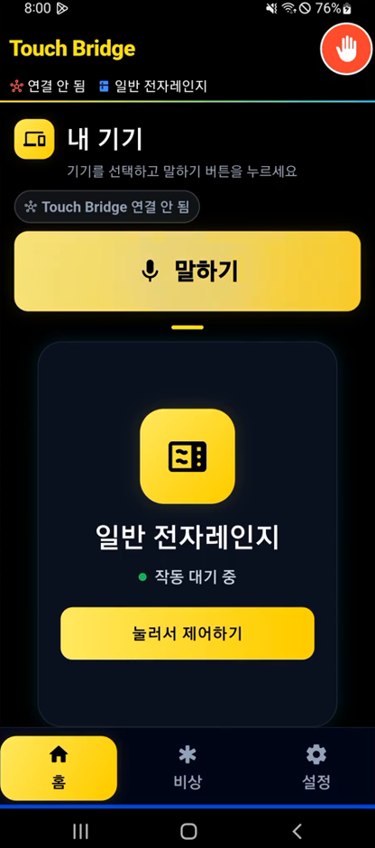
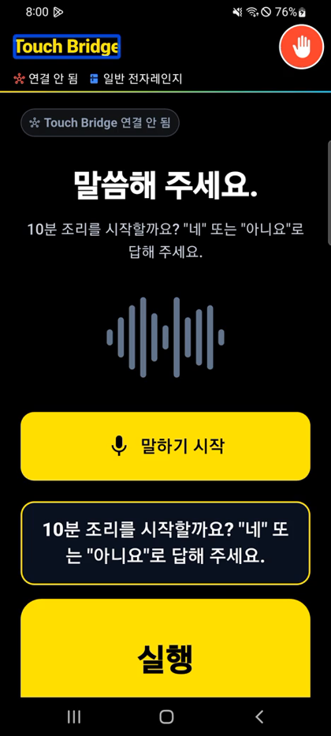
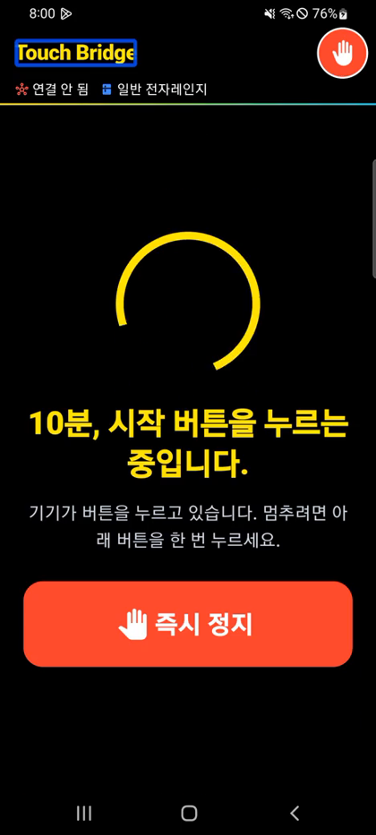
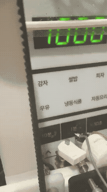
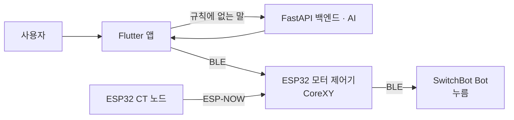

# Touch Bridge

시각장애인과 저시력자를 위한 가전 버튼 대리 입력 장치입니다. 말로 명령하면, 가전 터치 패널 위에 붙인 장치가 버튼을 대신 누릅니다.

2026 한이음 드림업 · 3팀 멜론머스크 · 2026.04 – 2026.11

<table>
  <tr>
    <td align="center"><br>말하기</td>
    <td align="center"><br>"10분 돌려줘" → 다시 묻기</td>
    <td align="center"><br>"네" → 누르는 중</td>
    <td align="center"><br>장치가 10분 버튼을 누름</td>
  </tr>
</table>

## 왜 만들었나

전자레인지·세탁기 같은 가전이 평평한 터치 패널로 바뀌면서, 손끝으로 버튼 위치를 찾을 수 없게 됐습니다. 위치를 찾으려고 더듬는 동작 자체가 잘못된 입력이 되기도 합니다. 점자 스티커나 음성 안내는 위치만 알려 줄 뿐 결국 사용자가 정확한 지점을 눌러야 하고, 스마트 가전으로 바꾸려면 비용이 큽니다.

Touch Bridge는 가전을 바꾸지 않고, 지금 쓰는 가전 위에 붙여서 버튼 누르는 일 자체를 대신합니다.

## 주요 기능

- **음성 명령:** "10분 돌려줘", "만두 데워줘"처럼 말하면 눌러야 할 버튼 순서를 만듭니다. 자주 쓰는 말은 앱이 바로 처리하고, 나머지는 AI가 해석합니다.
- **실행 전 확인:** 가전을 누르는 명령은 항상 "10분 조리를 시작할까요?"라고 다시 묻고, "네"라고 답해야 실행합니다.
- **즉시 정지:** 실행 중에는 화면의 정지 버튼을 한 번만 누르면 장치가 멈추고, 남은 명령은 보내지 않습니다.
- **사진으로 버튼 등록:** 보호자가 패널 사진을 찍으면 AI가 버튼 이름과 위치를 찾고, 네 모서리 보정으로 실제 mm 좌표를 계산합니다. 1·5·10mm 단위로 직접 맞출 수도 있습니다.
- **작동 확인:** 전류 센서(CT)로 가전이 실제로 켜지고 꺼졌는지 알려 줍니다.
- **화면 없이 사용:** 음성 안내와 진동으로 상태를 알리고, 화면 낭독기(TalkBack)와 함께 쓸 수 있습니다.

## 구조



자세한 설명은 [docs/ARCHITECTURE.md](docs/ARCHITECTURE.md)에 있습니다.

## 설계에서 신경 쓴 점

**안내와 실제 동작을 맞춘다.** 화면을 보지 못하는 사용자에게는 앱의 안내가 곧 결과입니다. 그래서 명령을 보낸 것과 장치가 실제로 동작한 것을 구분해 안내하고, 정지 응답을 받았을 때만 "멈췄습니다"라고 말합니다. 정지를 누르면 실행 토큰을 무효화해, 대기 중이던 명령과 복구 이동까지 모두 보내지 않습니다. 이 규칙을 정리한 논문이 학회에 게재됐습니다.

**AI는 버튼 이름까지만 정한다.** AI는 "10분 버튼, 시작 버튼" 같은 논리 버튼 ID만 돌려주고, 실제 좌표는 보호자가 확인하고 저장한 매핑에서만 나옵니다. AI가 잘못 답해도 엉뚱한 위치를 누르지 않습니다.

**의심스러운 명령은 실행하지 않는다.** "30초 시작하지 마"처럼 부정어가 있으면 규칙으로 실행하지 않고, "300분"처럼 비정상적인 시간은 20분으로 줄여서 다시 묻습니다.

**장치 명령은 인증한다.** 휴대폰과 장치는 HMAC 챌린지-응답으로 인증하고, 누르기 직전에는 장치가 발급한 1회용 위치 토큰을 확인합니다. 보안 설계와 남은 약점은 [docs/SECURITY.md](docs/SECURITY.md)에 정리했습니다.

## 기술 스택

| 영역 | 사용 기술 |
|---|---|
| 앱 | Flutter / Dart, `flutter_blue_plus`, `speech_to_text`, `flutter_tts` |
| 백엔드 | Python, FastAPI, Gemini(또는 학교 API 게이트웨이), MongoDB(선택) |
| 펌웨어 | ESP32(Arduino), 엔코더 DC 모터 + TB6612 드라이버, SwitchBot Bot, CT 센서(SEN0211) |
| CI | GitHub Actions (`flutter analyze`, `flutter test`, 백엔드 unittest) |

## 폴더 구성

```
lib/                 Flutter 앱
  screens/           홈 · 음성 · 비상 정지 · 보호자 설정 · 매핑 화면
  services/          명령 해석 · BLE · 좌표 변환 · 실행 · 음성 안내
backend/             FastAPI 서버 (명령 해석, 사진 분석)
hardware/
  touchbridge_corexy/  모터 제어기 펌웨어
  touchbridge_ct/      CT 노드 펌웨어
test/                앱 자동 테스트
docs/                구조 · 통신 규약 · 보안 · 실행 가이드
```

## 실행

```bash
cp .env_ex .env
flutter pub get
flutter run --dart-define=TOUCH_BRIDGE_DEMO=true   # 장치 없이 데모 데이터로 실행
```

백엔드와 실제 장치 연동은 [docs/REPRO_RUNBOOK.md](docs/REPRO_RUNBOOK.md)를 참고하세요.

## 검증 범위

| 상태 | 항목 |
|---|---|
| 실제 장치로 확인 | 음성 → 확인 질문 → 명령 전송, 앱 ↔ 장치 BLE 연결과 자동 재연결, 사진으로 버튼 위치 찾기, CT 작동 표시, 10분 버튼 실제 누름 |
| 자동 테스트로 확인 | 명령 해석 규칙, 정지 뒤 남은 명령 차단, 좌표 변환, BLE 명령 대기열, 접근성 의미 구조 (앱 685개 · 백엔드 57개) |
| 남은 과제 | 좌표 이동부터 누름까지 이어진 전체 흐름의 반복 시험, 정지 후 모터가 멈추는 시간 측정, 시각장애인 사용자 평가 |

## 팀

| 이름 | 역할 |
|---|---|
| 박성원 | 소프트웨어 — Flutter 앱, FastAPI 백엔드, AI 명령 해석, BLE 통신과 앱–펌웨어 규약, 테스트 |
| 서예솔 | 하드웨어 — CoreXY 기구 설계와 3D 프린팅, 배선과 전원, ESP32 펌웨어, CT 전류 측정 |

## 성과

- 논문: 박성원, 서예솔, 「시각장애인용 가전 입력 대행 시스템의 안내–동작 불일치 완화를 위한 소프트웨어 안전 계약」, 한국정보처리학회 ACK 2026 추계학술발표대회, 포스터 발표 (2026.11)
- 제24회 정보보호학과 프로젝트 발표회 부스 전시 (2026.11.18)
