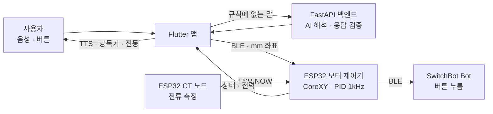

# 구조

## 전체 흐름

1. 사용자가 말하면 앱이 음성을 글자로 바꾼다(STT).
2. 자주 쓰는 명령("10분 돌려줘", "멈춰")은 앱 안의 규칙이 바로 해석하고, 나머지는 백엔드의 AI가 해석한다.
3. 해석 결과는 **논리 버튼 ID**(예: `BT-10`, `BT-05`)의 순서다. AI는 좌표를 만들지 않는다.
4. 가전을 누르는 명령은 실행 전에 반드시 사용자에게 다시 묻는다.
5. 앱이 보호자가 저장한 매핑에서 버튼 ID를 실제 mm 좌표로 바꿔 ESP32로 보낸다.
6. ESP32가 목표 위치로 이동한 뒤 SwitchBot Bot으로 버튼을 누르고 결과를 돌려준다.
7. CT 노드가 가전 전원선의 전류를 재서, 가전이 실제로 켜지고 꺼졌는지 앱에 알린다.

## 앱 (`lib/`)

| 영역 | 주요 파일 | 역할 |
|---|---|---|
| 화면 | `screens/home`, `screens/voice`, `screens/safety`, `screens/guardian` | 사용자 화면은 홈·음성·비상 정지만 둔다. 가전 등록과 버튼 위치는 '보호자 설정'에서만 연다 |
| 명령 해석 | `voice_intent_router.dart`, `appliance_command_router.dart`, `microwave_command_service.dart`, `ai_backend_service.dart` | 판정 순서를 고정한다: 비상 정지 → 취소 → 부정어(실행 안 함) → 문장 전체가 일치하는 규칙 → AI |
| 좌표 | `mapping_calibration_service.dart`, `device_mapping_service.dart` | 사진의 네 모서리와 실제 패널 크기로 4점 투영 변환(호모그래피)을 풀어, 버튼 중심을 mm 좌표로 바꾼다 |
| 실행 | `mapping_execution_service.dart`, `motion_controller.dart` | 버튼 순서를 장치 명령으로 보내고 결과를 기다린다. v2 경로는 `move_only` → 위치 토큰 → `press` 두 단계다 |
| 통신 | `ble_service.dart`, `ble_security_session.dart` | 명령을 한 줄씩 직렬로 보내고 응답을 기다린다. HMAC 세션 인증을 맡는다 |
| 정지 | `emergency_stop_service.dart`, `single_tap_stop_controller.dart` | 정지는 대기열을 거치지 않고 바로 보낸다. 실행 화면의 정지는 한 번 누르면 실행된다 |
| 안내 | `tts_service.dart`, `speech_session_service.dart` | 음성 안내에 우선순위를 두고, 낭독기(TalkBack)가 켜져 있으면 겹치지 않게 낭독기로 넘긴다 |
| 전력 | `power_status_service.dart` | CT 판정(작동·종료)을 받아 홈 화면과 음성으로 알린다 |

## 안전 규칙

화면을 보지 못하는 사용자에게는 앱의 안내가 곧 결과다. 그래서 안내와 실제 동작이 어긋나지 않도록 다음 규칙을 모든 실행 경로에 적용했다.

1. **확인된 것만 완료라고 말한다.** BLE 전송 성공은 "기기에 전달했습니다"로 안내하고, "멈췄습니다"는 장치의 정지 응답을 받았을 때만 말한다.
2. **정지 뒤에는 아무것도 보내지 않는다.** 실행마다 시작 시점의 실행 토큰(`motionEpoch`)을 기억해 하위 전송 함수까지 넘기고, 매 전송 전과 모든 대기 뒤에 비교한다. 토큰이 바뀌면 남은 명령과 복구 이동을 보내지 않는다. 토큰이 정해지기 전에 누른 정지도 따로 기록해 전송 직전에 확인한다.
3. **의심스러운 명령은 실행하지 않거나 다시 묻는다.** 부분 문자열로 규칙을 판정하지 않고, 부정어가 있으면 규칙으로 실행하지 않는다. 20분을 넘는 요청은 줄여서 되묻는다.

이 규칙은 회귀 테스트로 고정했고, 「시각장애인용 가전 입력 대행 시스템의 안내–동작 불일치 완화를 위한 소프트웨어 안전 계약」(ACK 2026)으로 정리했다.

## 백엔드 (`backend/`)

| 엔드포인트 | 역할 |
|---|---|
| `POST /parse-command` | 문장을 버튼 순서로 해석한다. 규칙에 맞으면 바로 답하고, 아니면 AI를 부른다 |
| `POST /vision-mapping` | 패널 사진에서 버튼 이름과 정규화 좌표를 찾는다 |
| `GET /healthz` | 상태 확인. 앱이 켜져 있는 동안 주기적으로 호출해 무료 서버가 잠들지 않게 한다 |

모든 응답은 `validation.py`의 스키마 검사를 거친다. AI 제공자는 `AI_PROVIDER`로 고른다(`google` 또는 학교 API 게이트웨이 `school`).

## 펌웨어 (`hardware/`)

- `touchbridge_corexy/`: 모터 제어기. 엔코더 DC 모터 두 개를 CoreXY로 움직이고 1kHz PID로 위치를 맞춘다. 벽에 닿는 것을 감지해 원점을 잡고, 목표 오차가 허용 범위 안일 때만 SwitchBot Bot에 누름을 요청한다. 앱의 v2 JSON, G-code, 텍스트 명령을 받는다.
- `touchbridge_ct/`: CT 노드. 전류를 재서 1초마다 ESP-NOW로 보낸다. 모터 제어기가 작동 여부를 판정해(100 W 이상 5초 → 작동, 15 W 이하 3초 → 종료) 앱에 전달한다.

명령과 응답 규격은 [ESP32_MOTION_PROTOCOL_V2.md](ESP32_MOTION_PROTOCOL_V2.md), [APP_FIRMWARE_CONTRACT.md](APP_FIRMWARE_CONTRACT.md), [HW_APP_INTEGRATION_CONTRACT_KO.md](HW_APP_INTEGRATION_CONTRACT_KO.md)를 본다.
